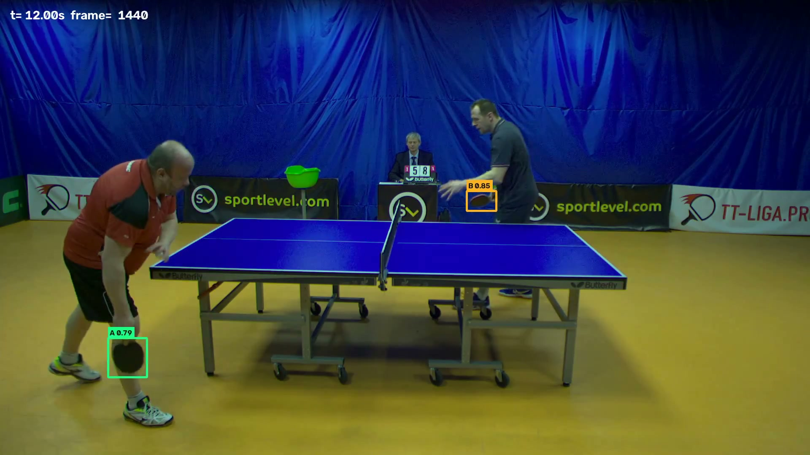
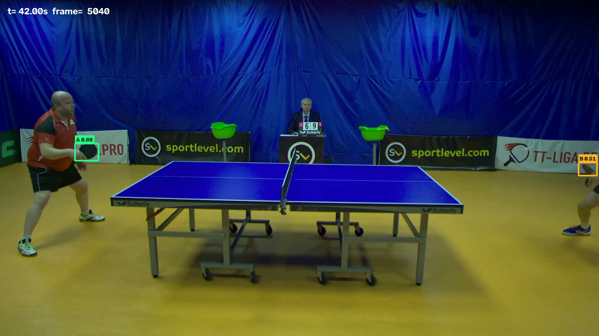

# 球拍检测模型 交付报告

| 项目 | 内容 |
|---|---|
| 对应方案 | 《球拍检测模型独立方案》路线 A：独立球拍模型 + 独立适配器 + Proposal 区间触发 |
| 交付日期 | 2026-11-09 |
| 交付物 | 训练权重 `racket_v8_960.pt`、推理适配器 `racket/`、评估报告、演示视频 |
| 数据规模 | 3 场不同比赛，400 帧，630 个球拍框 |

## 1. 结论

1. **模型可用**：在同一场地、未参与训练的比赛上，mAP@0.5 为 **0.61**（COCO 口径）/ **0.50**（部署链路），
   精确率 0.85、召回 0.51、侧别准确率 **1.00**。
2. **主要瓶颈是漏检，不是误检**：报出来的框 85% 是对的，但只找到约一半的球拍。
   快速对拉、球员交叉遮挡、球拍贴腿下垂时容易漏。
3. **侧别不需要模型学**：A/B 由球拍中心相对网线的位置判定，跨场次、换人、换边均为 1.00，
   且与计分状态机的 `player_side` 语义一致。
4. **输入分辨率是关键变量**：640 → 960 使 mAP 提升约 0.10，而单帧延迟只增加 9%。

**边界**：本模块只输出球拍证据，不参与判分。没有检测到球拍也不能判定"没有击球"。

## 2. 数据

| 场次 | 来源 | 时长 | 标注帧 | 框数 | 空帧（负样本） | 特点 |
|---|---|---|---|---|---|---|
| s01 | test_4 | 5 分钟 | 150 | 209 | 13 | 中途两人换边 |
| s02 | test_2 | 30 秒 | 120 | 203 | 1 | 不同选手、同机位 |
| s03 | test_3 | 65 秒 | 130 | 218 | 5 | 不同选手、同机位 |

标注规范：每帧一至两支球拍，框住拍面与拍柄；侧别按**物理半台**（A=画面左半台，B=右半台），
换边不随人改变；不可见则留空，作为负样本；帧间按 2–4 fps 采样，避免相邻帧冗余。

标注由半自动流程产出后人工复核：先用上一版模型低阈值预填，再逐帧修正。
未复核的帧不进入训练（`reviewed` 标记），避免把"还没标"当成"没有球拍"。

## 3. 方法

```text
单类别 YOLOv8n 检测"球拍"（不分类 A/B）
        ↓
按中心 x 相对网线判侧别（压线判 UNKNOWN，不猜）
        ↓
轻量跟踪（IoU + 匀速预测）→ track_id、速度、方向、断轨
        ↓
rack 适配器输出 racket.v1 观测（字段对齐方案 §6）
        ↓
融合层 / 计分状态机（本阶段未接入判分）
```

关键设计：

- **单类别而非三类别**：三个类别中若某侧无样本，模型会在空类别上乱输出（实测精确率跌到 0.01）。
  单类别 + 几何定侧别后精确率回到 0.99。
- **困难负样本**：用"同一侧出现两支球拍"和"检测框对不上真值"两种规则自动挖误检，
  裁成无标注背景图加入训练（共 100 张），专治空手、桌腿、台面白边被认成球拍。
- **按场次留出评估**：不参与训练的比赛整段作测试集，无相邻帧泄漏。

## 4. 结果

### 4.1 跨场次评估（部署阈值 0.5，IoU 0.5）

| 模型 | 训练场次 | 输入 | 测试 s02 | 测试 s03 |
|---|---|---|---|---|
| v6 | s01 | 640 | 0.544 | 0.352 |
| v7 | s01 | 960 | 0.642 | 0.454 |
| **v8（交付）** | **s01 + s02** | **960** | 0.986（训练集，不适用） | **0.496** |

v8 在 s03 上的完整指标（ultralytics/COCO 口径）：mAP@0.5 **0.608**，精确率 **0.756**，召回 **0.564**。

### 4.2 两个有效结论

**其一，分辨率提升稳定有效。** 固定训练数据与测试场次，只改输入尺寸：

| 输入 | s02 mAP | s03 mAP | 提升 |
|---|---|---|---|
| 640 | 0.544 | 0.352 | — |
| 960 | 0.642 | 0.454 | **+0.10** |

球拍在 1920 画面中仅约 70 px，640 输入下只剩 23 px；960 下细节才够用。
实测 P50 延迟 14.4 ms → 15.7 ms（+9%），瓶颈在前后处理。

**其二，多一场训练数据有正向收益。** 同为 960、同测 s03：0.454 → 0.496。

### 4.3 部署开销（RTX 2080 Ti）

| 输入 | P50 | P95 | 备注 |
|---|---|---|---|
| 640 | 14.4 ms | 15.8 ms | — |
| 960 | 15.7 ms | 17.2 ms | 采用 |

### 4.4 新机位实测（test_1，未参与训练）

第四段视频换了机位（更高俯角、右侧选手背对镜头），用于检验“换机位还能不能用”。
用 v8 逐帧推理（20 fps 采样、960 输入、阈值 0.5）：

| 口径 | A 侧检出率 | B 侧检出率 | 两侧同时 |
|---|---|---|---|
| 全部帧 | 43.9% | 34.1% | 12.8% |
| **仅活跃帧**（排除死球间歇） | **45.7%** | **52.4%** | **21.7%** |

最长连续漏检：A 侧 6.9 秒、B 侧 9.7 秒（多发生在换球、擦汗等间歇）。

**结论**：这个机位下，**约一半的击球时刻拿不到击球方的球拍证据**。
主要原因是右侧选手背对镜头、球拍频繁被躯干遮挡，左侧选手距离更远、目标更小。
这类画面在当前训练数据中没有覆盖，属于明确的泛化缺口。

配套素材：`球拍检测_test1_漏检观察.mp4`（画面底部实时显示两侧检出状态与累计漏检时长）、
`coverage_test1_timeline.png`（全场检出覆盖时间轴）。

## 5. 与方案验收指标的对应

| 方案 §10 指标 | 状态 |
|---|---|
| 球拍检测 precision / recall / mAP | ✅ 已测（0.756 / 0.564 / 0.608） |
| 球拍跟踪断轨时长 | ✅ 已实现统计，未纳入正式验收 |
| 击球方侧别准确率 | ✅ 1.00 |
| 击球事件 precision / recall / F1 | ❌ 缺击球区间标注 |
| 整回合错分率、自动判分覆盖率 | ❌ 需接入融合层后才能测 |
| 端到端 P50 / P95 延迟 | ✅ 单模型已测，整链路未测 |
| 显存、内存、功耗、温度 | ❌ 未测（板端 RK3588） |
| 无球拍、遮挡、多人交叉的拒判质量 | ⚠️ 定性观察，未定量 |

## 6. 演示视频

最终模型（v8，s01+s02 训练、s03 未参与训练）在 **test_3.mp4** 上的逐帧结果，
检测框已烧进画面：

| 项目 | 内容 |
|---|---|
| 文件 | `球拍检测_演示_v8最终版.mp4`（工程内：`reports/demo_test3_v8_final.mp4`） |
| 规格 | 1920×1080，30 fps，65 秒，37 MB，H.264 |
| 检测设置 | imgsz 960，置信度阈值 0.5，每侧最多保留一支 |
| 平均检出 | 每帧 1.02 支球拍（画面可见约 1.68 支） |

画面左上角为时间戳与帧号，框上标注侧别与置信度；**绿色 = A（画面左半台），橙色 = B（右半台）**。

典型帧一（t=12s）：左侧选手球拍垂在胯侧、右侧选手举拍于胸前，两支都检出（A 0.79 / B 0.85）。
这是 640 版本会漏掉低位置球拍的一类画面。



典型帧二（t=42s）：左侧选手正常持拍检出（A 0.80）；右侧选手已基本走出画面，
边缘的 B 0.51 落在其手上，属于**临界误检**——这类可以通过缩小有效视野或把阈值提到 0.6 过滤掉。



**看这段视频时建议关注**：

1. 快速对拉时是否有一支球拍整段消失（对应召回 0.56 的漏检）；
2. 球拍垂到腿边、贴住身体时是否还能跟上；
3. 是否有空手、桌边被误报成球拍（对应精确率 0.76 的误检）。

## 7. 局限

1. **测试集只有一场比赛**（130 帧）。跨场次 mAP 的单次估计波动较大，结论需要第四段视频复核。
2. **召回仍是短板**：0.51~0.56。漏检集中在快速对拉、球员交叉、球拍贴腿。
3. **板端未验证**：本报告延迟均来自桌面显卡（RTX 2080 Ti）。RK3588 无独显，
   960 输入的实际帧率、内存与温度需上板重测，必要时改用 ONNX + 量化并回退 640。
4. **标注规模有限**：400 帧、3 名选手，覆盖不到真实球馆的灯光、机位与人群多样性。
5. **未接判分链路**：球拍证据尚未接入 `EventFusion`，`HIT_score` 权重仍是待校准基线。

## 8. 复现

```powershell
# 环境（一次性）
py -3.11 -m venv D:\racket-env
D:\racket-env\Scripts\python.exe -m pip install torch torchvision --index-url https://download.pytorch.org/whl/cu124
D:\racket-env\Scripts\python.exe -m pip install ultralytics imageio-ffmpeg opencv-python-headless scikit-image

cd D:\work\racket

# 训练（s01+s02 训练，s03 整场测试）
D:\racket-env\Scripts\python.exe scripts\sandbox_train.py data/labels_all3.jsonl 80 weights/yolov8n.pt v8_960_cross 960 8 20 cross data/backgrounds_s01s02

# 评估
D:\racket-env\Scripts\python.exe scripts\eval_all.py runs/detect/runs/v8_960_cross/weights/best.pt data/videos/test_3/labels_s03.jsonl 0.5 1 960

# 生成演示视频（对应第 6 节的 mp4）
D:\racket-env\Scripts\python.exe scripts\demo_video.py runs/detect/runs/v8_960_cross/weights/best.pt --video "C:\Users\rokmy\Downloads\test_3.mp4" --out reports\demo_test3_v8_final.mp4 --fps 30 --conf 0.5 --imgsz 960

# 单元测试（51 项）
D:\racket-env\Scripts\python.exe -m unittest discover -s tests -t .
```

推理接入：

```python
from racket.adapter import AdapterConfig, RacketAdapter
from racket.detectors import YoloRacketDetector
from racket.detectors.base import DetectorConfig

adapter = RacketAdapter(
    YoloRacketDetector("racket_v8_960.pt", DetectorConfig(conf_thr=0.5, imgsz=960)),
    AdapterConfig(session_id="s01", conf_thr=0.5),
)
observations = adapter.process_frame(frame_bgr, frame_id, timestamp_s, (1920, 1080))
# 每条观测均为 racket.v1，字段与方案 §6 一致
```

## 9. 下一步建议

| 优先级 | 事项 | 理由 |
|---|---|---|
| 高 | 补第四段视频做复核 | 现在的 0.61 只来自一场测试 |
| 高 | 补标"快速对拉 / 交叉遮挡 / 贴腿"难样本 | 直接对应漏检主因 |
| 中 | 接入 EventFusion，按方案 §12.4 校准 HIT 权重 | 球拍证据才有业务价值 |
| 中 | RK3588 上板测延迟与温度 | 决定 960 能否上板 |
| 低 | 与球检测模型合并为多类别 | 方案 §4 路线 B，需在基线稳定后再评估 |

