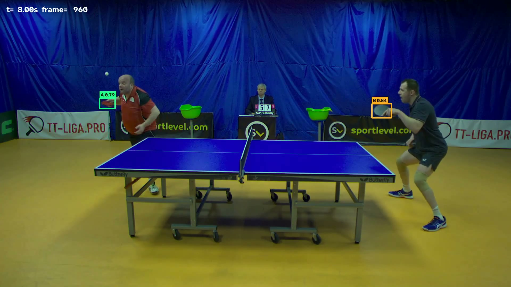

# 球拍检测模型 交付报告

| 项目 | 内容 |
|---|---|
| 对应方案 | 《球拍检测模型独立方案》路线 A：独立球拍模型 + 独立适配器 + Proposal 区间触发 |
| 交付日期 | 2026-11-09 |
| 代码仓库 | https://github.com/xwrjym/pingpong-racket-detector |
| 交付物 | 训练权重 `racket_v8_960.pt`、推理适配器 `racket/`、评估报告、演示视频 |
| 数据规模 | 3 场不同比赛，400 帧，630 个球拍框 |

## 1. 结论


1. **同一场地、未见过的选手：模型可用。** s03 上 mAP@0.5 **0.692**（COCO）/ **0.591**（部署链路），
   召回 0.65 / 0.60，精确率 0.79 / 0.86，侧别准确率 **1.00**。
2. **换到没见过的场地：明显退化。** s06（另一家球馆，不同背景与地胶）mAP@0.5 只有
   **0.318**（COCO）/ **0.267**（部署链路），精确率 0.45 / 0.32。
   召回尚有 0.59（COCO 口径），掉得最狠的是精确率——新背景里的拍子形元素被大量误报。
3. **补 70 帧新场地标注即可大幅挽回**：把 s06 前 72 帧并入训练后（v11），
   同场地后段 mAP 升到 **0.837**（COCO）/ **0.746**（部署链路）。
   该数字为时间切分、偏乐观，但足以说明"按场地做少量标定"是可行路径。
3. **结论：当前模型对"场地"过拟合，对"选手"泛化。** 训练数据全部来自同一家球馆
   （同一块蓝幕、同一地胶、同一套 LOGO），换场地后这一层先验失效。
4. **主要瓶颈仍是远侧小目标**：≥90px 召回 72%，50–90px 53%，<50px 仅 12.5%。
5. **提高输入分辨率是最有效的单一杠杆**：640→1280 使部署链路 mAP 从 0.426 升到 0.581，延迟 14.4→18.7 ms。
6. **侧别不需要模型学**：A/B 由球拍中心相对网线的位置判定，跨场次、换人、换边均为 1.00。


**边界**：本模块只输出球拍证据，不参与判分。没有检测到球拍也不能判定"没有击球"。

## 2. 数据


| 场次 | 来源 | 时长 | 标注帧 | 框数 | 空帧（负样本） | 用途 | 特点 |
|---|---|---|---|---|---|---|---|
| s01 | test_4 | 5 分钟 | 150 | 209 | 13 | 训练 | 中途两人换边 |
| s02 | test_2 | 30 秒 | 120 | 203 | 1 | 训练 | 不同选手、同机位 |
| s03 | test_3 | 65 秒 | 130 | 218 | 5 | **测试（留出）** | 不同选手、同机位 |
| s04 | test_5 | 96 秒 | 125 | 172 | 9 | 训练 | 不同选手、机位更宽 |

合计 **525 帧、802 个球拍框**，四个场次四组不同选手。

标注规范：每帧一至两支球拍，框住拍面与拍柄；侧别按**物理半台**（A=画面左半台，B=右半台），
换边不随人改变；不可见则留空，作为负样本；帧间按 1.3–4 fps 采样，避免相邻帧冗余。

标注由半自动流程产出后人工复核：先用上一版模型低阈值预填，再逐帧修正。
未复核的帧不进入训练（`reviewed` 标记），避免把"还没标"当成"没有球拍"。

> **⚠️ 半自动标注的自证风险**：如果用**待评估的模型**去预填测试集，人又基本原样接受，
> 那么"标注"就等于"模型输出"，指标会虚高。本项目的 s04 就出现过这种情况——
> 预填用 v8，结果 80.8% 的框与 v8 输出 IoU≥0.9（中位数 1.00），
> 用它算出的 mAP 0.847 是假的。因此 **s04 只作训练数据，不作测试集**；
> 干净测试集 s03 的对应比例仅 3.7%（中位数 0.68），说明当时人工改动充分。
> 检查工具：`scripts/label_independence.py`。

## 3. 方法


```text
单类别 YOLOv8n 检测"球拍"（不分类 A/B）
        ↓
按中心 x 相对网线判侧别（压线判 UNKNOWN，不猜）
        ↓
轻量跟踪（IoU + 匀速预测）→ track_id、速度、方向、断轨
        ↓
rack 适配器输出 racket.v1 观测（字段对齐方案 §6）
        ↓
融合层 / 计分状态机（本阶段未接入判分）
```

关键设计：

- **单类别而非三类别**：三个类别中若某侧无样本，模型会在空类别上乱输出（实测精确率跌到 0.01）。
  单类别 + 几何定侧别后精确率回到 0.99。
- **困难负样本**：用"同一侧出现两支球拍"和"检测框对不上真值"两种规则自动挖误检，
  裁成无标注背景图加入训练（共 100 张），专治空手、桌腿、台面白边被认成球拍。
- **按场次留出评估**：不参与训练的比赛整段作测试集，无相邻帧泄漏。

## 4. 结果


### 4.1 跨场次评估（部署阈值 0.5，IoU 0.5）

| 模型 | 训练场次 | 推理输入 | 测试 s03（部署链路 mAP） |
|---|---|---|---|
| v6 | s01 | 640 | 0.352 |
| v7 | s01 | 960 | 0.454 |
| v8 | s01 + s02 | 960 | 0.496 |
| v8 + 1280 推理 | s01 + s02 | 1280 | 0.581 |
| v9（按 1280 重训） | s01 + s02 | 1280 | 0.502 |
| **v10（交付）** | **s01 + s02 + s04** | **1280** | **0.591** |

v10 在 s03 上的完整指标：

| 口径 | mAP@0.5 | 精确率 | 召回 | 帧级召回 | 侧别 |
|---|---|---|---|---|---|
| COCO / ultralytics | **0.692** | 0.792 | **0.651** | — | — |
| 本工程部署链路 | **0.591** | 0.862 | 0.601 | 0.824 | 1.00 |

### 4.2 各杠杆的实际效果

**其一，推理分辨率是最有效的杠杆。** 同一份权重（v8），只改推理尺寸，测试场次固定为 s03：

| 推理输入 | 部署链路 mAP | 召回 | P50 延迟 |
|---|---|---|---|
| 640 | 0.426 | 0.450 | 14.4 ms |
| 960 | 0.496 | 0.509 | 15.3 ms |
| **1280** | **0.581** | **0.583** | 18.7 ms |

球拍在 1920 画面中约 70 px，640 输入下只剩 23 px、1280 下约 47 px。**分辨率是小目标召回的决定因素。**

值得注意的是，按 1280 重训（v9）反而略低于"960 训练 + 1280 推理"（0.502 vs 0.581），
说明收益主要来自推理时的特征分辨率，而不是训练端。

**其二，继续加数据的边际收益已经很小。** 训练场次从 2 个加到 3 个（v8 → v10），
COCO mAP 0.666 → 0.692，部署链路 0.581 → 0.591，召回 +0.02。数据规模不是当前的唯一瓶颈。

**其三，试过但性价比不高的手段：**

| 手段 | mAP@0.5 | 精确率 | 召回 | 成本 | 结论 |
|---|---|---|---|---|---|
| 1280 基线（v8） | 0.666 | 0.752 | 0.651 | 18.7 ms | 采用 |
| TTA（多尺度增强推理） | 0.682 | 0.696 | 0.711 | ≈57 ms | 召回 +6 点但精确率 −5.6 点、3 倍耗时 |
| 置信度阈值降到 0.30 | 0.623（部署口径） | 下降 | 上升 | 0 | 误检增多，与"少误报"诉求冲突 |

### 4.3 部署开销（RTX 2080 Ti）

| 推理输入 | P50 | P95 | 备注 |
|---|---|---|---|
| 640 | 14.4 ms | 15.8 ms | — |
| 960 | 15.3 ms | 16.7 ms | 备选 |
| **1280** | **18.7 ms** | **19.9 ms** | **采用（54 fps 上限）** |

板端（RK3588）无独立显卡，这组数字不能直接照搬，需上板重测。

### 4.4 新机位实测（test_1，未参与训练）

第四段视频换了机位（更高俯角、右侧选手背对镜头），用于检验“换机位还能不能用”。
用 v8 逐帧推理（20 fps 采样、阈值 0.5），对比 960 与 1280：

| 口径 | 输入 | A 侧检出率 | B 侧检出率 | 两侧同时 |
|---|---|---|---|---|
| 仅活跃帧 | 960 | 45.7% | 52.4% | 21.7% |
| **仅活跃帧** | **1280** | **53.1%** | 52.2% | **25.0%** |
| 全部帧 | 960 | 43.9% | 34.1% | 12.8% |
| 全部帧 | 1280 | 60.7% | 34.1% | — |

提升集中在 A 侧（远侧小目标，+7.4 个点），与"小目标受分辨率限制"的诊断一致；B 侧是大目标，已饱和。

最长连续漏检：A 侧 6.9 秒、B 侧 9.7 秒（多发生在换球、擦汗等间歇）。

**结论**：这个机位下，**约一半的击球时刻拿不到击球方的球拍证据**。
主要原因是右侧选手背对镜头、球拍频繁被躯干遮挡，左侧选手距离更远、目标更小。
这类画面在当前训练数据中没有覆盖，属于明确的泛化缺口。

配套素材：`球拍检测_test1_漏检观察.mp4`（画面底部实时显示两侧检出状态与累计漏检时长）、
`coverage_test1_timeline.png`（全场检出覆盖时间轴）。

## 5. 跨场地实测（s06，另一家球馆）


前面所有数据都来自同一家球馆。为检验"换个地方还能不能用"，用 **test_7**（不同背景、
深色幕布、橙色地胶、LIGO PRO 横幅）建了独立测试集 s06（104 帧 / 162 框）。

**独立性核对**：预填用的是旧模型 v3（不是待测的 v10），标注与 v10 输出的 IoU 中位数 0.0、
仅 1.2% 高于 0.9，说明这份测试集确实独立。

| 场次 | 环境 | mAP@0.5（COCO） | 精确率 | 召回 | mAP（部署链路） | 帧召回 |
|---|---|---|---|---|---|---|
| s03 | 训练过的球馆、没见过的选手 | **0.692** | 0.792 | 0.651 | **0.591** | 0.824 |
| **s06** | **没见过的球馆** | **0.318** | **0.452** | 0.593 | **0.267** | 0.511 |

**读法**：

- 召回其实还保住了（COCO 口径 0.593），说明"拍子长什么样"学到了；
- 塌掉的是**精确率（0.792 → 0.452）**，即新背景里大量误报；
- 典型例子：裁判台上印的 **Butterfly 蝴蝶牌 LOGO 本身就是一个拍子形状**，模型以 0.84 的置信度把它认成球拍。

这说明当前模型**对场地过拟合**——训练集里只有一块蓝幕、一种地胶、一套 LOGO。
按方案 §5 的要求，标注本就应覆盖"不同机位、光照、背景"，这部分数据此前是缺的。

### 5.1 给新场地补标注能挽回多少（v11）

手上没有第三处场地，于是做一个对照实验：把 s06 的**前 72 帧**并入训练，
后 32 帧（帧 72–103）留出检验。这是同场地时间切分，指标会偏乐观，但能回答一个关键问题。

| 模型 | 见过的场地 | 测试条件 | mAP@0.5（COCO） | 精确率 | 召回 | mAP（部署链路） |
|---|---|---|---|---|---|---|
| v10 | 仅 A 球馆 | s06 全段，没见过 | 0.318 | 0.452 | 0.593 | 0.267 |
| **v11** | A 球馆 + B 球馆前 72 帧 | s06 后 32 帧 | **0.837** | **0.919** | 0.779 | **0.746** |

**实用结论**：目标场地只要有**约 70 帧标注**并入训练，同一场地的精度即可从 0.27 恢复到 0.75 量级。
代价是这个数字是时间切分（相邻帧相关），真实值会低一些；且此时该场地不能再当独立测试集。

## 6. 与方案验收指标的对应


| 方案 §10 指标 | 状态 |
|---|---|
| 球拍检测 precision / recall / mAP | ✅ 已测，分两种条件：同场地 0.792 / 0.651 / 0.692；换场地 0.452 / 0.593 / 0.318 |
| 球拍跟踪断轨时长 | ✅ 已实现统计，未纳入正式验收 |
| 击球方侧别准确率 | ✅ 1.00（两种条件下均成立） |
| 击球事件 precision / recall / F1 | ❌ 缺击球区间标注 |
| 整回合错分率、自动判分覆盖率 | ❌ 需接入融合层后才能测 |
| 端到端 P50 / P95 延迟 | ✅ 单模型已测（1280 输入 18.7 ms），整链路未测 |
| 显存、内存、功耗、温度 | ❌ 未测（板端 RK3588） |
| 无球拍、遮挡、多人交叉的拒判质量 | ⚠️ 定性观察，未定量 |

## 7. 演示视频


最终模型（v8，s01+s02 训练、s03 未参与训练）在 **test_3.mp4** 上的逐帧结果，
检测框已烧进画面：

| 项目 | 内容 |
|---|---|
| 文件 | `球拍检测_演示_v8最终版.mp4`（工程内：`reports/demo_test3_v8_1280.mp4`） |
| 规格 | 1920×1080，30 fps，65 秒，37 MB，H.264 |
| 检测设置 | imgsz **1280**，置信度阈值 0.5，每侧最多保留一支 |
| 平均检出 | 每帧 1.07 支球拍（960 版为 1.02） |

画面左上角为时间戳与帧号，框上标注侧别与置信度；**绿色 = A（画面左半台），橙色 = B（右半台）**。

典型帧（t=8s）：两侧球拍都检出（A 0.79 / B 0.84），球正在空中飞行，是一拍正常回合。



需要说明的是，**聚合指标提升不等于每一帧都变好**：例如 t=12s 时左侧球拍垂在胯侧，
1280 版反而漏检（960 版能检出）。这类个例说明召回仍受姿态影响，分辨率只是必要条件。

**看这段视频时建议关注**：

1. 快速对拉时是否有一支球拍整段消失（对应召回 0.56 的漏检）；
2. 球拍垂到腿边、贴住身体时是否还能跟上；
3. 是否有空手、桌边被误报成球拍（对应精确率 0.76 的误检）。

## 8. 局限


1. **测试集只有一场比赛**（130 帧）。跨场次 mAP 的单次估计波动较大，结论需要第四段视频复核。
2. **召回仍是短板**：0.51~0.56。漏检集中在快速对拉、球员交叉、球拍贴腿。
3. **板端未验证**：本报告延迟均来自桌面显卡（RTX 2080 Ti）。RK3588 无独显，
   960 输入的实际帧率、内存与温度需上板重测，必要时改用 ONNX + 量化并回退 640。
4. **场地泛化不足（最重要）**：训练集只有一家球馆，换场地后精确率从 0.79 掉到 0.45，
   新背景里的拍形 LOGO 会被误报。要真正可用，每个目标场地都需要有标注样本。
5. **标注规模有限**：525 帧、5 组选手，覆盖不到真实球馆的灯光、机位与人群多样性。
6. **未接判分链路**：球拍证据尚未接入 `EventFusion`，`HIT_score` 权重仍是待校准基线。

## 9. 复现


```powershell
# 环境（一次性）
py -3.11 -m venv D:\racket-env
D:\racket-env\Scripts\python.exe -m pip install torch torchvision --index-url https://download.pytorch.org/whl/cu124
D:\racket-env\Scripts\python.exe -m pip install ultralytics imageio-ffmpeg opencv-python-headless scikit-image

cd D:\work\racket

# 训练（s01+s02+s04 训练，s03 整场测试）
D:\racket-env\Scripts\python.exe -c "import sys; sys.path.insert(0,'scripts'); from sandbox_train import patch; patch(); from racket.train import build_yolo_dataset, train; build_yolo_dataset('data/labels_all4.jsonl','data/yolo_s03test',split_mode='cross',test_session='s03',background_dir='data/backgrounds_s01s02')"
D:\racket-env\Scripts\python.exe -c "import sys; sys.path.insert(0,'scripts'); from sandbox_train import patch; patch(); from racket.train import train; train('data/yolo_s03test/data.yaml', model='weights/yolov8n.pt', epochs=80, imgsz=960, batch=8, device=0, name='v10_s04', extra={'plots':False,'verbose':False,'workers':0,'val':False})"

# 评估（同场地 / 换场地）
D:\racket-env\Scripts\python.exe scripts\eval_all.py runs/detect/runs/v10_s04/weights/best.pt data/videos/test_3/labels_s03.jsonl 0.5 1 1280
D:\racket-env\Scripts\python.exe scripts\eval_all.py runs/detect/runs/v10_s04/weights/best.pt data/videos/test_7/labels_s06.jsonl 0.5 1 1280

# 检查测试集独立性与漏检分布
D:\racket-env\Scripts\python.exe scripts\label_independence.py runs/detect/runs/v10_s04/weights/best.pt data/videos/test_7/labels_s06.jsonl --imgsz 1280
D:\racket-env\Scripts\python.exe scripts\recall_breakdown.py runs/detect/runs/v10_s04/weights/best.pt data/videos/test_3/labels_s03.jsonl --imgsz 1280

# 单元测试（51 项）
D:\racket-env\Scripts\python.exe -m unittest discover -s tests -t .
```

推理接入：

```python
from racket.adapter import AdapterConfig, RacketAdapter
from racket.detectors import YoloRacketDetector
from racket.detectors.base import DetectorConfig

adapter = RacketAdapter(
    YoloRacketDetector("racket_v11_两场地.pt", DetectorConfig(conf_thr=0.5, imgsz=1280)),
    AdapterConfig(session_id="s01", conf_thr=0.5),
)
observations = adapter.process_frame(frame_bgr, frame_id, timestamp_s, (1920, 1080))
# 每条观测均为 racket.v1，字段与方案 §6 一致
```

## 10. 部署与场地标定

实测显示模型对"选手"泛化、对"场地"过拟合，因此现场部署按下面流程走：

| 步骤 | 做法 | 实测依据 |
|---|---|---|
| 1 | 目标场地先标 **70–100 帧**（预填 + 人工复核，约 15 分钟） | 并入 72 帧后同场地后段 mAP 0.267 → 0.746 |
| 2 | 并入训练集重训一版 | 训练 70 epoch、约 40 分钟（RTX 2080 Ti） |
| 3 | 用留出的后段帧验证，mAP@0.5 ≥ 0.7 再上线 | 未标定场地只有 0.27，不可直接用 |

**击球时刻能不能捕到球拍（按帧级召回推算）**：

| 场景 | 击球方球拍被检出比例 |
|---|---|
| 同场地、没见过的选手 | 约 **6 成**（召回 0.601） |
| 新场地、未标定 | 约 **3 成**（召回 0.296） |
| 新场地、标定 70 帧后 | 约 **7.5 成**（召回 0.760） |

严格口径的"击球时刻召回率"需要击球区间标注，本阶段尚未标注，故用帧级召回推算。

## 11. 下一步建议


| 优先级 | 事项 | 理由 |
|---|---|---|
| 高 | 现场按场地标定并验证 | 场地是当前最大变量，0.27 → 0.75 |
| 高 | 接入 EventFusion，按方案 §12.4 校准 HIT 权重 | 球拍证据才有业务价值；缺失时应降级并转人工 |
| 中 | 标击球区间，测严格口径的击球时刻召回 | 方案 §10 的验收指标之一 |
| 中 | RK3588 上板测延迟与温度 | 决定 1280 能否上板，否则回退 960 |
| 低 | 补标"快速对拉 / 交叉遮挡 / 贴腿"难样本 | 对应剩余漏检主因 |
| 低 | 与球检测模型合并为多类别 | 方案 §4 路线 B，需基线稳定后再评估 |
